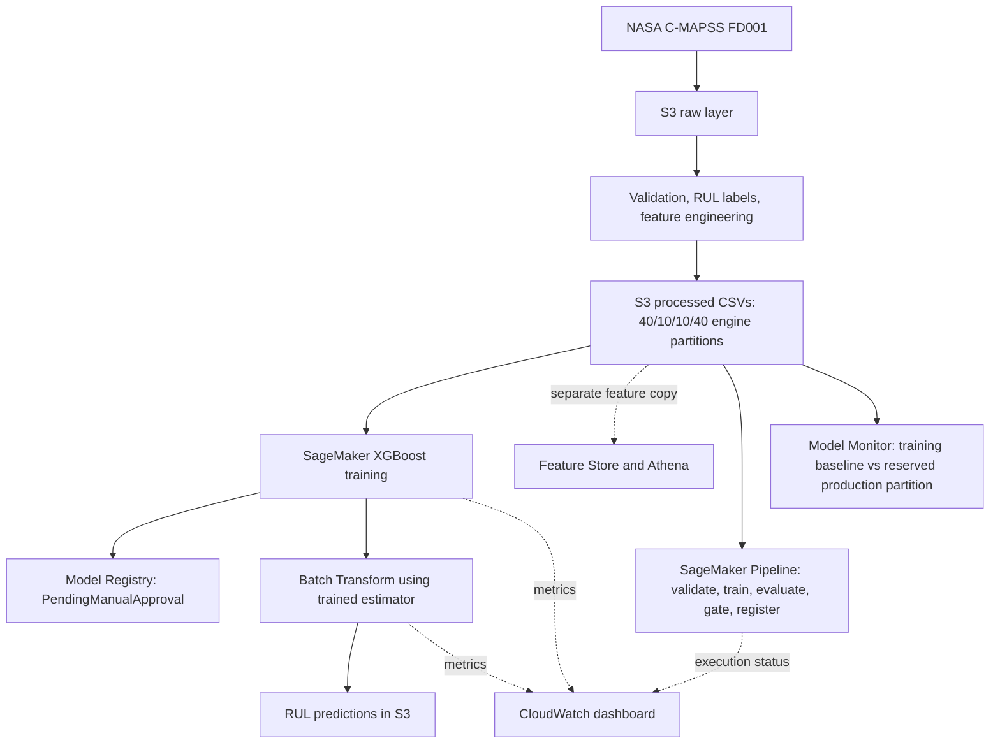

# Turbofan Remaining Useful Life Prediction

**AeroReliability Analytics — AAI-540 MLOps, Group 4**<br>
University of San Diego, M.S. Applied Artificial Intelligence, Fall 2026<br>
**Team:** Andrew Blumhardt and Dylan Scott-Dawkins

This project implements an end-to-end machine learning operations workflow on Amazon SageMaker for estimating the **Remaining Useful Life (RUL)** of aircraft turbofan engines. It uses the NASA C-MAPSS **FD001** dataset and produces an engine-specific estimate of how many operating cycles remain before end of life.

The final system includes an S3 data lake, data validation, feature engineering, SageMaker Feature Store and Athena integration, model training and registration, batch inference, SHAP interpretability, Model Monitor reports, CloudWatch dashboards, and a SageMaker Pipeline demonstrated in both successful and failed states.

## Quick SageMaker evaluation

To review the project without rebuilding it, open [`final_submission/AAI540_Turbofan_RUL_AWS_SageMaker.ipynb`](final_submission/AAI540_Turbofan_RUL_AWS_SageMaker.ipynb) in GitHub. The committed notebook contains the outputs from a completed AWS run, including model results and evidence for the required SageMaker components.

To run it in your own SageMaker environment:

1. Clone this repository into SageMaker Studio or a SageMaker notebook instance.
2. Open a terminal in `final_submission/` and run:

   ```bash
   pip install -r requirements.txt
   ```

3. Open `AAI540_Turbofan_RUL_AWS_SageMaker.ipynb` **from that directory** and run it from top to bottom. The notebook downloads FD001 and creates the required S3 and SageMaker resources.
4. Use the `RUN_*` flags near the top to disable stages you do not want to launch.

> [!CAUTION]
> A full run creates billable AWS resources, including managed training, Batch Transform, Feature Store, Model Monitor, pipeline executions, and CloudWatch resources. The demonstrated environment used Python 3.12.14, pandas 2.3.3, scikit-learn 1.7.2, and SageMaker Python SDK 2.257.7.

## Reviewer guide

| Item | Location |
|---|---|
| **Primary notebook: complete system, Modules 2–7** | [`final_submission/AAI540_Turbofan_RUL_AWS_SageMaker.ipynb`](final_submission/AAI540_Turbofan_RUL_AWS_SageMaker.ipynb) |
| SageMaker Pipeline step scripts | [`final_submission/pipeline_scripts/`](final_submission/pipeline_scripts) |
| CloudWatch dashboard implementation | [`final_submission/cloudwatch_monitoring_setup.py`](final_submission/cloudwatch_monitoring_setup.py) |
| S3 data layout and generated artifacts | [`final_submission/data/README.md`](final_submission/data/README.md) |
| Earlier notebooks, experiments, and planning material | [`archive/`](archive) — preserved for reference, not part of the final system |

The complete ML System Design Document and demonstration video are submitted separately as course deliverables. This README is the concise implementation and evaluation guide for the repository.

## Why predict RUL instead of using a fixed replacement interval?

A fixed rule—replace every five years or after a set number of cycles—assumes engines age at the same rate. They do not. Even in the controlled FD001 simulation, the 100 training engines lasted from **128 to 362 cycles**, a 2.8-to-1 range. A conservative schedule based on the shortest life would discard substantial useful life from many engines, while a schedule based on the average could allow faster-degrading engines to run too long.

This model adds a condition-based signal. It evaluates each engine's recent sensor history and estimates remaining cycles, allowing maintenance to be planned earlier for engines degrading quickly and deferred for engines that remain healthy. It does not replace mandatory inspections, regulated life limits, or engineering judgment.

The project did not directly benchmark a fixed-interval maintenance policy, so this rationale is based on the observed lifespan spread rather than a demonstrated cost or safety comparison.

The method also differs from a single-sensor alarm by combining engine age, multiple sensor values, and trailing 5- and 10-cycle means and standard deviations. SHAP analysis shows that the prediction depends most strongly on cycle count and rolling trends in sensors 17, 4, and 3. The result is a planning horizon in cycles rather than only a binary alert. We did not benchmark the model against a single-sensor or threshold-based maintenance policy, so this project does not claim demonstrated superiority over those approaches.

## Results and interpretation

| Model | Evaluation set | RMSE (cycles) | MAE (cycles) |
|---|---|---:|---:|
| Linear regression benchmark | 10-engine validation partition | 31.01 | 23.21 |
| SageMaker XGBoost | 10-engine validation partition | approximately 23.0 | Not recorded |
| SageMaker XGBoost via Batch Transform | 10-engine held-out test partition | **20.10** | **14.10** |

XGBoost substantially improved on the linear benchmark. Its test MAE means that predictions were off by about 14 cycles on average. The model approximately achieved the project's 15–20 cycle target, with test RMSE of 20.10 just above its upper boundary.

The result is promising for a course-scale system, but it is not evidence of production readiness:

- Training RMSE was approximately 9.2 compared with approximately 23.0 on validation data, indicating some overfitting.
- Validation and test partitions contained only 10 engines each; repeated grouped validation and confidence intervals were not computed.
- The separate NASA-provided test histories were loaded and feature-engineered but were not scored.
- Performance was not reported separately for low-RUL engines, where late predictions carry the greatest operational risk.
- Model Monitor flagged 2 of 52 features, but both were near-zero-mean operating settings for which percentage change is unstable; the sensor features remained stable.

The defensible conclusion is that the project demonstrates a working, repeatable, monitored ML system and a credible model on simulated FD001 data. It is not ready to guide real aircraft maintenance.

## System architecture



Training reads prepared CSV files from S3. Feature Store receives a separate copy of the engineered data for lookup and reuse; it is not the training source. Batch Transform uses the trained estimator directly. The registry records the candidate version as `PendingManualApproval`. Approval is recorded for governance purposes but is not enforced in the demonstrated Batch Transform path.

Batch inference was selected because maintenance predictions are expected to run periodically. An always-on endpoint would add cost and operational complexity without a corresponding benefit for this use case.

## Implementation summary

- **Data:** FD001 provides 20,631 run-to-failure records from 100 training engines and 13,096 truncated records from another 100 engines.
- **Labels:** `RUL = engine maximum cycle − current cycle`, capped at 125 cycles.
- **Partitions:** 40 train, 10 validation, 10 test, and 40 reserved-production engines. Splitting by engine prevents lifecycle leakage between partitions.
- **Target balance:** Healthy-state records outnumber critical low-RUL records 4.1 to 1. The imbalance was analyzed, but the final system applies neither weighting nor resampling; low-RUL evaluation remains future work.
- **Features:** Seven constant fields are removed. The final model uses 52 features, including trailing rolling means and standard deviations for eight degradation-sensitive sensors.
- **Training:** A linear-regression benchmark is compared with managed SageMaker XGBoost training on `ml.m5.large`.
- **Deployment:** Batch Transform produces test predictions and writes them to S3.
- **Interpretability:** SHAP explains global feature importance for the trained XGBoost model.
- **Monitoring:** Model Monitor compares the reserved-production partition with the training baseline. CloudWatch reports model, drift, and pipeline metrics.
- **CI/CD:** The SageMaker Pipeline validates data, trains and evaluates XGBoost, gates registration at a default RMSE threshold of 30 cycles, and conditionally registers the candidate model.

## Assignment evidence map

The primary notebook retains the outputs from the completed run. It also writes an evidence manifest to S3 with AWS resource names, ARNs, and console links.

| Required component | Notebook location | Demonstrated evidence |
|---|---|---|
| S3 data lake | Sections 3–4 and 9 | Raw and processed prefixes |
| Feature Store and feature group | Section 11 | 20,631 ingested records |
| Model Registry | Section 14 | Versioned package in `PendingManualApproval` |
| Batch inference | Section 15 | Predictions plus RMSE and MAE |
| Model/data monitoring | Section 16 | Baseline and current reports for 52 features |
| CI/CD DAG | Module 6 pipeline section | One successful execution and one deliberate validation failure |
| Infrastructure monitoring | Section 17 | CloudWatch dashboard populated with metrics from the run |
| Final evidence manifest | Final notebook section | Consolidated S3 and AWS resource references |

The failed pipeline execution uses a deliberately corrupted training file with a missing feature column. `ValidateTrainingData` rejects it before training, demonstrating that invalid input does not proceed through the workflow.

## Maintenance, limitations, and future work

FD001 contains run-to-failure histories but no maintenance events. The model therefore learns how sensor behavior changes when an engine operates until failure; it does not know that replacing a component can restore performance. Improved post-maintenance readings could raise the estimate, but cycle count—the strongest feature—continues increasing and could cause the model to understate the remaining life of a repaired engine. SHAP identifies which inputs drive a prediction, but it does not diagnose the failing component.

A stronger future system would:

- score the external NASA test engines and report grouped cross-validation with confidence intervals;
- use the NASA asymmetric scoring function or another metric that penalizes dangerously late predictions more heavily;
- include maintenance events, component replacements, and cycles since overhaul as model inputs;
- report performance separately for critical low-RUL engines;
- add prediction intervals so planners can see estimate uncertainty;
- expand to FD002–FD004 and validate on representative real fleet data;
- deploy from an approved registry package and add unit tests, GitHub Actions, scheduled monitoring, and retraining triggers.

Earlier LSTM, Transformer, TCN, ensemble, imbalance-mitigation, and model-comparison experiments are retained in [`archive/`](archive). They are not part of the validated final system and are not used to support the results above.

## Security, bias, and responsible use

The dataset is simulated and contains no personal, health, financial, or user-behavior data. AWS access is provided through the SageMaker execution role; a production implementation should enforce least-privilege IAM permissions, block public S3 access, and encrypt stored data.

The primary bias is operational rather than demographic: FD001 represents one engine family, one operating condition, and one fault mode. Predictions should not be generalized to other engines or environments. An optimistic estimate could delay required maintenance, while a conservative estimate could waste usable life. The model must remain a decision-support tool reviewed by qualified personnel.

## Cost control and cleanup

All `RUN_*` flags currently default to `True`. Set unneeded stages to `False` before running. When evaluation is complete, delete the SageMaker pipeline, feature group, model package group, CloudWatch dashboards and alarms, Athena database, and the `aai540-turbofan-rul/` S3 prefix to avoid ongoing charges.

## Repository layout

```text
final_submission/
├── AAI540_Turbofan_RUL_AWS_SageMaker.ipynb
├── cloudwatch_monitoring_setup.py
├── data/
│   └── README.md
├── pipeline_scripts/
│   ├── evaluate.py
│   └── validate_data.py
├── README.md
└── requirements.txt

archive/        Earlier notebooks, experiments, planning documents, and original README
LICENSE
README.md       Project landing page and evaluation guide
```

Tag `v2-working-snapshot` preserves the exact repository state before the final reorganization. File history was retained through `git mv`.

## AI assistance disclosure

We used AI tools as assistants throughout the project. Early in the work, ChatGPT helped organize the scope, refine language, and outline starter code. Andrew used GitHub Copilot while organizing the repository and developing project documentation. Dylan used Claude while developing and debugging the SageMaker notebook, pipeline scripts, and monitoring implementation.

The team reviewed and modified the suggestions, ran the notebook in its own AWS environment, and checked the results reported here against the saved execution outputs. The authors remain responsible for the system design, implementation, interpretation, and final submission.

## Dataset and license

This project uses the [NASA C-MAPSS Turbofan Engine Degradation dataset](https://www.nasa.gov/intelligent-systems-division/discovery-and-systems-health/pcoe/pcoe-data-set-repository/). Dataset use remains subject to NASA's terms and attribution requirements. Repository code is released under the terms in [`LICENSE`](LICENSE).
