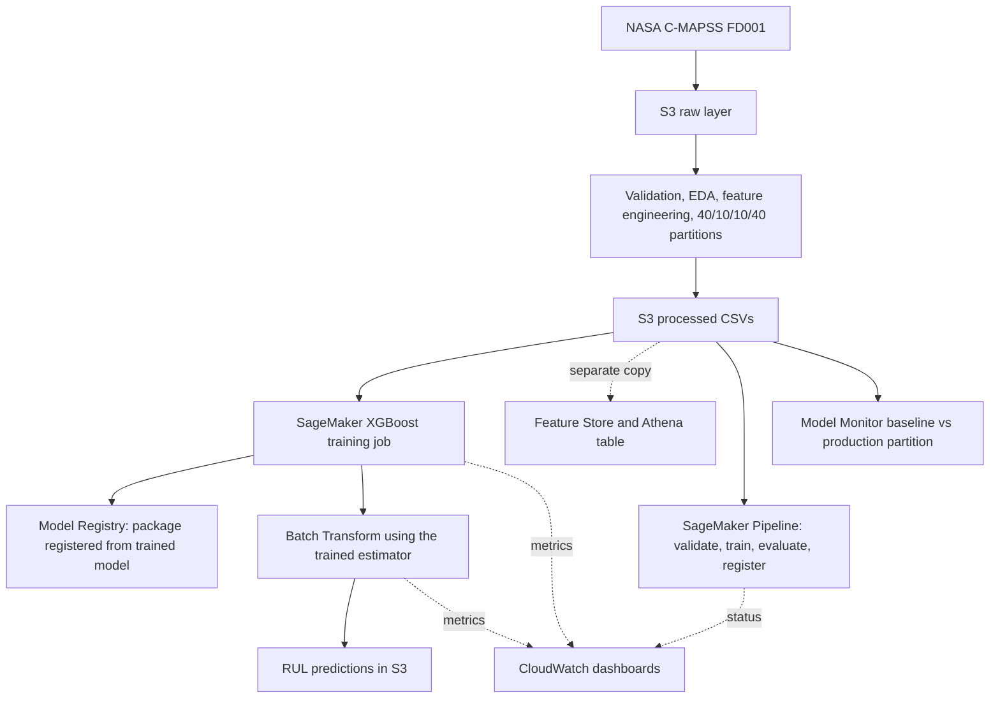

# Turbofan Remaining Useful Life (RUL) Prediction - AeroReliability Analytics

**AAI-540 MLOps, Group 4** | University of San Diego, M.S. Applied Artificial Intelligence | Fall 2026
**Team:** Andrew Blumhardt, Dylan Scott-Dawkins

An end-to-end MLOps system on Amazon SageMaker that predicts the Remaining Useful Life (in operating cycles) of aircraft turbofan engines from sensor data, using the NASA C-MAPSS **FD001** dataset.

## Start here (for reviewers)

| What | Where |
|---|---|
| **Primary notebook (the complete system, Modules 2-7)** | [`final_submission/AAI540_Turbofan_RUL_AWS_SageMaker.ipynb`](final_submission/AAI540_Turbofan_RUL_AWS_SageMaker.ipynb) |
| SageMaker Pipeline step scripts | [`final_submission/pipeline_scripts/`](final_submission/pipeline_scripts) |
| CloudWatch dashboard setup | [`final_submission/cloudwatch_monitoring_setup.py`](final_submission/cloudwatch_monitoring_setup.py) |
| Data location and layout (S3) | [`final_submission/data/README.md`](final_submission/data/README.md) |
| Earlier work, experiments, planning notes | [`archive/`](archive) (not part of the final submission) |

Design document, video, and Asana links: _add links here before submission._

## Business problem and ML framing

Maintenance performed too late risks unscheduled downtime; maintenance performed too early wastes useful engine life. We frame this as a **supervised regression** problem: given an engine's operating settings and 21 sensor readings, predict the cycles remaining before end of life. Success is measured by **RMSE** (primary, penalizes large misses) and **MAE** (average error in cycles), with a target RMSE near the 15-20 cycle range typical of FD001 baselines. The model is a decision-support concept and not a replacement for qualified maintenance personnel or safety procedures.

## Results

| Model | Evaluation set | RMSE (cycles) | MAE (cycles) |
|---|---|---|---|
| Linear regression benchmark | Validation | 31.01 | 23.21 |
| SageMaker XGBoost (Batch Transform) | Held-out test | **20.10** | **14.10** |

SHAP analysis of the trained XGBoost model (notebook section 15a) shows the engine `cycle` count and 10-cycle rolling means of sensors 17, 4 and 3 as the strongest drivers of predictions. Model Monitor profiled 52 features against the training baseline and flagged 2.

## Architecture



Training reads the prepared CSVs from S3. The Feature Store holds a separate copy of the engineered features for reuse and lookup. Batch Transform runs from the trained estimator; the registry entry documents the model version but is not what Batch Transform deploys.

Batch inference was chosen because maintenance predictions are generated periodically; an always-on real-time endpoint would add cost without benefit.

## Where each course component is implemented

All items are sections of the primary notebook; run output is saved in the notebook and an evidence manifest (resource names, ARNs, console links) is written to S3 at the end.

| Module | Component | Notebook section |
|---|---|---|
| 2 | S3 data lake (raw FD001 upload) | 3-4 |
| 3 | Data validation, EDA, RUL labels, label-imbalance analysis, feature engineering, partitions, Athena, **Feature Store** | 5-11 |
| 4 | Linear-regression benchmark, XGBoost training job, **Model Registry**, **Batch Transform**, SHAP interpretability | 12-15a |
| 5 | **SageMaker Model Monitor** baseline and drift report | 16 |
| 6 | **CloudWatch dashboards** and **SageMaker Pipeline (CI/CD)** with a successful run and a deliberately failed run (corrupted training data) | 17 and Module 6 |
| 7 | Evidence manifest for the demo video | final section |

## Method summary

- **Data:** FD001 has 100 training engines run to failure and 100 truncated test engines (one operating condition, one fault mode). Raw and processed files live in S3 (see `final_submission/data/README.md`); no datasets are committed to Git.
- **Labels:** RUL = max cycle for an engine minus current cycle, capped at 125.
- **Features:** Constant sensors removed; rolling mean (5 and 10 cycles) and standard-deviation features per sensor.
- **Splits:** 40/10/10/40 train/validation/test/production partitions, split by engine ID so no engine appears in more than one partition. The production partition is reserved for monitoring and drift comparison.
- **Pipeline controls:** `validate_data.py` stops the pipeline on bad input; `evaluate.py` writes metrics the pipeline uses to gate model registration on RMSE.

## Reproducing the run

1. Use SageMaker Studio or a notebook instance with an execution role that can use S3, SageMaker, Athena, Glue, and CloudWatch.
2. Install dependencies: `pip install -r final_submission/requirements.txt` (tested with Python 3.12, pandas 2.3.3, scikit-learn 1.7.2 and SageMaker Python SDK 2.257.7; keep the SDK on v2).
3. Open the notebook from inside `final_submission/` (it reads `pipeline_scripts/` by relative path) and run top to bottom. **Running top to bottom launches billable AWS jobs** (Feature Store, training, Batch Transform, Model Monitor, pipeline executions, dashboards). All `RUN_*` flags near the top default to `True`; set a flag to `False` to skip that stage.
4. **Cleanup:** when finished, delete the SageMaker pipeline, feature group, model package group, CloudWatch dashboards and alarms, Athena database, and the `aai540-turbofan-rul/` S3 prefix from the AWS console or CLI to avoid ongoing charges.

## Security, bias, and ethics notes

The data is simulated and contains no personal information. Access is through the SageMaker execution role with scoped S3 prefixes. Because FD001 covers one operating condition and one fault mode, results should not be generalized to other engines or conditions. Predictions must be reviewed by qualified personnel.

## Repository layout

```
final_submission/   Final deliverable code (notebook, pipeline scripts, monitoring, data docs)
archive/            Earlier notebooks, experiments (TCN, LSTM/Transformer, ensembles), planning docs,
                    and the original planning-stage README. Preserved for reference only.
LICENSE
```

The repository was reorganized from a flat working layout. Tag `v2-working-snapshot` marks the exact state before reorganization, and git history is preserved for every moved file.

## AI tool disclosure

AI-assisted tools (including GitHub Copilot) were used during development and documentation. All code and results were reviewed, executed, and validated by the team. _Team to confirm and expand this statement with specific usage before submission._

## Dataset and license

NASA C-MAPSS Turbofan Engine Degradation dataset, [NASA Prognostics Center of Excellence repository](https://www.nasa.gov/intelligent-systems-division/discovery-and-systems-health/pcoe/pcoe-data-set-repository/); use is subject to NASA's terms and attribution requirements. Repository code is released under the license in [`LICENSE`](LICENSE).

